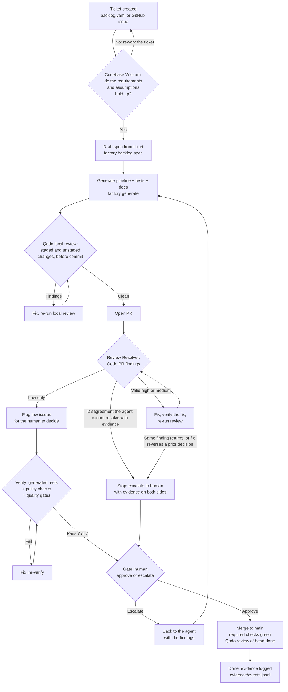

# Day 10 — Factory with verification (diagram)

(Qodo Hackathon Day 10, Fri Nov 13, 2026 — "Factory with verification."
Email: "Day 10: Factory with verification", msg `1a1d4cc4571e8b2b`,
from Filip Hric at Qodo. Challenge: post a diagram of the factory
with its verification steps.)

## The diagram

## Quality gates — what must pass, what evidence, what happens on failure

| Check | What must pass | Evidence the agent uses | On failure |
| --- | --- | --- | --- |
| Codebase Wisdom (ticket → spec) | Requirements and assumptions hold up against the codebase; no reinvented solution | Ticket body + spec + codebase context | Ticket reworked; spec not drafted |
| Qodo local review (before commit) | No blocking findings in staged/unstaged changes | Local static review (security / correctness / best practice) + Qodo review engine | Fix and re-run local review; do not commit |
| Review Resolver (PR findings) | Valid high and medium findings fixed and verified; low flagged for human | Qodo PR findings (imported as JSON) + resolver plan (scope high/medium/all) | Fix, verify the fix, re-run review |
| Verify (tests + policy + gates) | Generated tests pass; no hardcoded secrets; all PII de-identified; `eval` confined to `_derive`; completeness and uniqueness meet thresholds on synthetic data | `verify-report.txt` (7 checks) + generated test output + synthetic run (governed/quarantined counts) | Fix and re-verify; gate cannot approve |
| Gate (human) | Verification passed; required checks green; Qodo review of current PR head complete | Gate decision + evidence log | Escalate back to the agent with findings; no merge |
| Merge to main | Definition of Done met (see `docs/definition-of-done.md`) | Evidence-log entry + artifacts | Not merged; stays open |

## Definition of Done (carried from Day 9)

Settle valid high and medium issues, verify the fixes, and flag low
issues for the human's decision. Before merge: passing required
checks and a completed Qodo review of the current PR head. Full text:
`docs/definition-of-done.md`.

## Check against one real ticket

**Ticket used:** PF-1 — "Governed intake pipeline for synthetic
patient records" (from `examples/backlog.yaml`).
**Run checked:** `day5-run-001`, Nov 12, 2026 — full loop
(ticket → spec → generate → review → verify → approve).
Artifacts: `evidence/day5-first-reviewed-pr/`.

### What worked

- Every step in the diagram was exercised: PF-1 → spec
  (`spec-patient-intake.yaml`) → generate (pipeline + tests + docs)
  → review (4 findings, 0 high) → verify (**7/7 checks passed**,
  synthetic run 49 governed / 1 quarantined, completeness 1.000,
  uniqueness 1.000) → gate **approved**.
- The fix-and-review loop worked as drawn: the 4 findings were all
  lower severity, so at scope `high` 0 were selected and 4 were
  deferred to the next round — exactly the "low flagged for human
  decision" path.
- The verify gate caught a real failure the same day: the
  intake-drafted `lab-results-intake` spec failed verify 6/7
  ("generated tests" file-not-found). Root cause was a real bug in
  `verify.py` (relative `--out` path + pytest cwd). Fixed the same
  day with a regression test; re-run passed 7/7. The failure and the
  fix are both in the evidence log.

### What the human had to do

- **Gate approval.** The human approved the run ("all 7 verification
  checks passed"). Approve is blocked unless verification passed, so
  the human's job was the decision, not re-checking the tests.
- **Defer the low findings.** The 4 lower-severity review findings
  were deferred to the next round — a human scoping decision, not an
  agent default.

### Gaps / missing verification (honest)

1. **No GitHub PR was opened.** The code was pushed directly to
   `main` (catch-up after a late Nov 12 registration), so the
   "merge to main" step was a direct push, not a reviewed PR merge.
   The diagram shows the intended PR flow; the Day 5 run did not
   exercise the PR-merge path.
2. **No Qodo review of a PR head on file.** The review in the Day 5
   run was the factory's local static review + PR Resolver plan —
   not a Qodo review of a PR head. The "Qodo review of current PR
   head complete" gate has not been exercised yet.
3. **Codebase Wisdom and Qodo local review were not run as Qodo
   tool invocations.** The ticket→spec review was the factory's own
   spec validation, and the local review was the factory's static
   checker. The Qodo CLI steps (Day 6 Wisdom, Day 8 local review)
   are still to be run against a real PR.

These gaps are why the repo's Day 1 ("verify via Qodo PR review")
and Day 6 (Codebase Wisdom) are marked BUILT, not DONE. They close
when a real PR goes through Qodo review.
